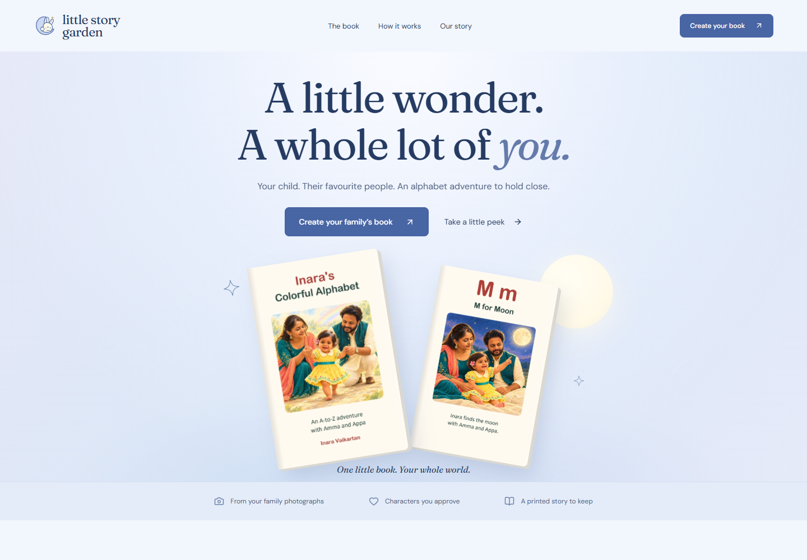

# Little Story Garden

[Visit Moonlit Garden](https://acoaria4.github.io/littlestorygarden-preview/)

A dreamy blue website for personalised family alphabet books. Moonlit Garden is the chosen direction, with the approved Sleepy Bunny logo. Sample pages run alphabetically: A Apple, E Elephant, M Moon, Z Zebra. Development source and the handoff remain in a separate private repository; this repository holds only compiled preview artifacts.



Browse sample book pages, discover the family story, and try the creation preview. [Earlier concepts](https://acoaria4.github.io/littlestorygarden-preview/concepts/) preserve the three original directions.

## Creation preview

Family details and photographs stay in browser memory and disappear on refresh. They are not uploaded. Inara's explicitly labelled sample family demonstrates per-person approval, correction notes, and book preview. Generation, storage, payments, printing, and fulfilment are not connected. No orders can be placed.

## Run locally

Clone this repository into a directory named `littlestorygarden-preview`, then run from its parent:

```sh
python -m http.server 4173 --bind 127.0.0.1
```

Open `http://127.0.0.1:4173/littlestorygarden-preview/`. Stop with Ctrl+C. This compiled build uses that URL base path; rebuilds happen in the private source project.

## Assets and hosting

Static Next.js/React export with GSAP and self-hosted DM Sans/Fraunces fonts from Fontsource. The original Inara alphabet-book artwork is shared for the authorised review. No original family photographs, source history, credentials, source maps, handoff, or reference snapshots are included. No general reuse licence is granted for the artwork or project. Font licences are in `font-licences/`.

GitHub Pages serves `main:/` with `.nojekyll` to support `_next` assets. The site and artifacts are public. Noindex and robots directives discourage indexing; they are not access controls.
