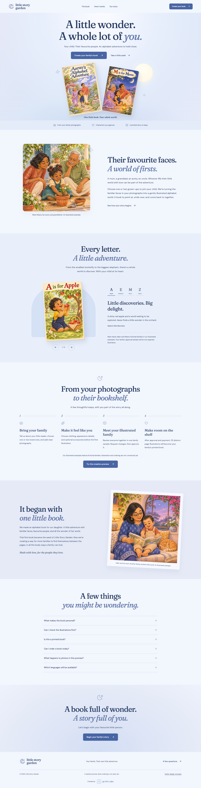

# Little Story Garden

[Visit Moonlit Garden](https://acoaria4.github.io/littlestorygarden-preview/)

A dreamy blue website for personalised family alphabet books. Moonlit Garden is the chosen direction, with the approved Sleepy Bunny logo. Sample pages run alphabetically: A Apple, E Elephant, M Moon, Z Zebra. Development source and the handoff remain in a separate private repository; this repository holds only compiled preview artifacts.



Browse sample book pages, discover the family story, and try the creation preview. [Earlier concepts](https://acoaria4.github.io/littlestorygarden-preview/concepts/) preserve the three original directions.

## Creation preview

Family details, photographs, appearance/clothing/accessory choices, and correction notes stay in browser memory and disappear on refresh. They are not uploaded. Select the baby's gender (Male/Female), one or two adults, and each adult's relationship and optional preferred name. Photo uploads, preferences, and review controls follow that family size. Removing the second adult discards their data. Relevant changes reset the combined sample's approvals.

The active website uses fictional illustrated sample families: Aarav with his grandmother and uncle, Meera with her aunty and grandfather, and Kabir with his mum. A/E/M/Z examples feature those different families; they are separate from the one family approval sample. The creation demonstration shows Aarav with one or two adults as selected. Visitor choices and correction notes do not change existing artwork. Generation, storage, payments, printing, and fulfilment are not connected. No orders can be placed.

## Run locally

Clone this repository into a directory named `littlestorygarden-preview`, then run from its parent:

```sh
python -m http.server 4173 --bind 127.0.0.1
```

Open `http://127.0.0.1:4173/littlestorygarden-preview/`. Stop with Ctrl+C. This compiled build uses that URL base path; rebuilds happen in the private source project.

## Assets and hosting

Static Next.js/React export with GSAP and self-hosted DM Sans/Fraunces fonts from Fontsource. The active website's fictional family illustrations were created with the built-in image generation tool; no personal photographs were used. Earlier design concepts preserve previously authorised original book artwork. No original family photographs, source history, credentials, source maps, costing documents, handoff, or reference snapshots are included. No general reuse licence is granted for the artwork or project. Font licences are in `font-licences/`.

GitHub Pages serves `main:/` with `.nojekyll` to support `_next` assets. The site and artifacts are public. Noindex and robots directives discourage indexing; they are not access controls.
